# Linux Sysadmin Lab 01 — Ubuntu VM မှ Nginx Web Page အထိ


| Environment | Lab value |
| --- | --- |
| Server | Ubuntu 26.04.1 LTS VM (`shiva`) |
| Client | Windows PC, PowerShell နှင့် browser |
| Server IP | အစပိုင်း `192.168.100.115`၊ နောက်ပိုင်း `192.168.100.119` |
| Client IP | `192.168.100.110` |
| Web service | Nginx, HTTP port `80` |

> IP တွေက private lab network မှာသုံးခဲ့တာပါ။ VM ပြန်ဖွင့်ရင် IP ပြောင်းနိုင်ပါတယ်။ ကိုယ့်စက်မှာ ပြန်လုပ်မယ်ဆို `hostname -I` နဲ့ IP အသစ်ကို စစ်ပါ။

## 1. User, group နဲ့ shared directory

`labs-ops` group နဲ့ `lab-user` ကိုဖန်တီးပြီး user ကို group ထဲထည့်ခဲ့ပါတယ်။ `id lab-user` နဲ့ `getent group labs-ops` က membership ကို ပြပါတယ်။

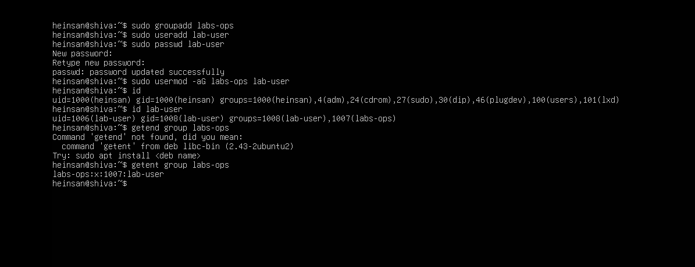

`/srv/labs-share` ကို `root:labs-ops`, mode `2770` အဖြစ်သတ်မှတ်ခဲ့ပါတယ်။ `770` က owner/group ကို access ပေးပြီး others ကို ပိတ်ပါတယ်။ ရှေ့က `2` က setgid ဖြစ်လို့ ဒီ folder အောက်မှာ အသစ်ဖန်တီးတဲ့ file တွေက folder ရဲ့ `labs-ops` group ကို ဆက်ခံပါတယ်။ `root` ကို owner ထားတာက folder ကို သာမန် group member တစ်ယောက်က အလွယ်တကူ ပြင်မရစေဖို့ပါ။

```bash
sudo mkdir -p /srv/labs-share
sudo chown root:labs-ops /srv/labs-share
sudo chmod 2770 /srv/labs-share
sudo ls -ld /srv/labs-share
```

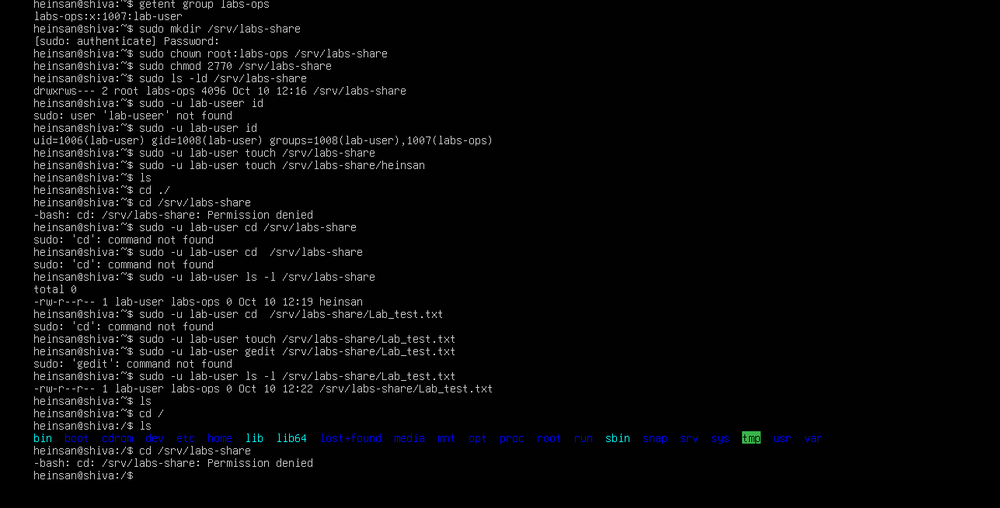

`sudo -u lab-user` နဲ့ file ရေး/ဖတ်နိုင်ပေမယ့် group မဝင်ထားတဲ့ `heinsan` က file ကို တိုက်ရိုက်ဖတ်တဲ့အခါ `Permission denied` ဖြစ်ပါတယ်။ ပုံထဲမှာ စမ်းသပ်ရင်း ရိုက်မိတဲ့ command typo တချို့လည်း ပါပါတယ်။

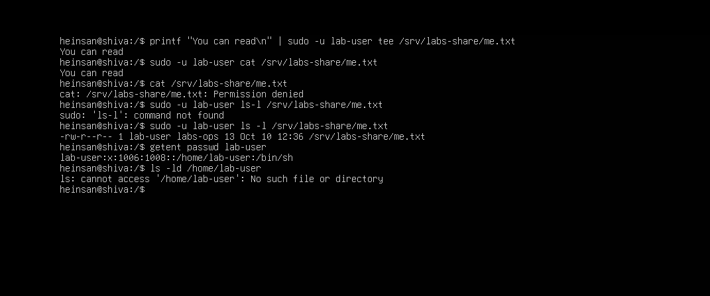

## 2. Windows မှ SSH login

Windows PowerShell ကနေ Ubuntu VM သို့ public-key authentication ကိုသာ လက်ခံမယ့် client-side command နဲ့ ဝင်ခဲ့ပါတယ်။ `PasswordAuthentication=no` က **ဒီ SSH connection အတွက်** password fallback ပိတ်တာဖြစ်ပြီး server တစ်ခုလုံးရဲ့ SSH setting ကို ပြောင်းထားတာ မဟုတ်ပါ။ `heinsan@shiva:~$` prompt က login အောင်မြင်ကြောင်း ပြပါတယ်။

```powershell
ssh -o PreferredAuthentications=publickey -o PasswordAuthentication=no heinsan@192.168.100.115
```

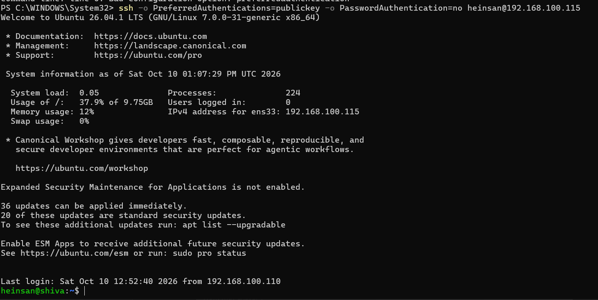

## 3. UFW baseline နှင့် package ပြုပြင်ခြင်း

`sudo ufw status verbose` မှာ firewall `active`, incoming `deny`, SSH port `22` `ALLOW` ဖြစ်နေပါတယ်။ ဒါကို နောက်ပိုင်း web access ပြဿနာစစ်ရာမှာ baseline အဖြစ်သုံးခဲ့ပါတယ်။

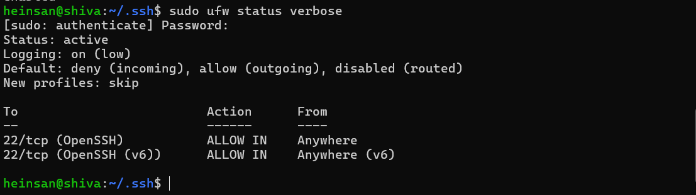

`sudo dpkg --audit` က `rsyslog` half-configured ဖြစ်နေကြောင်း ပြခဲ့ပါတယ်။ `sudo dpkg --configure -a` ပြီးနောက် audit ထပ်လုပ်ရာ output မရှိတော့ပါ။

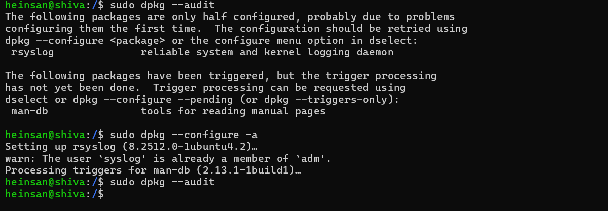

## 4. Nginx ကို VM အတွင်း စစ်ခြင်း

Nginx install လုပ်ပြီး `systemctl status nginx` မှာ `active (running)` နှင့် `enabled` ဖြစ်ပါတယ်။ `curl -I http://127.0.0.1` က `HTTP/1.1 200 OK` ပြန်ပါတယ်။ Local test အောင်မြင်ခြင်းက VM **အတွင်း** web server အလုပ်လုပ်ကြောင်း ပြပြီး Windows က ဝင်နိုင်မနိုင်ကို သီးခြားစစ်ရပါတယ်။

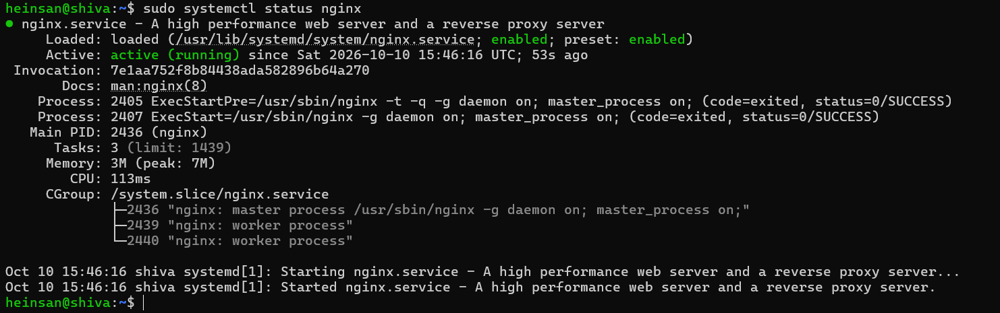

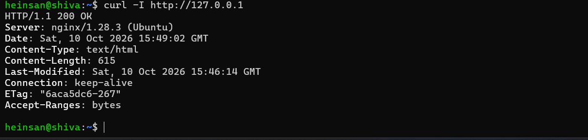

## 5. Windows မှ port 80 connection ကို troubleshoot လုပ်ခြင်း

Windows မှ VM ၏ port `80` ကို စမ်းရာ `PingSucceeded: True` ဖြစ်သော်လည်း `TcpTestSucceeded: False` ဖြစ်ခဲ့ပါတယ်။ Network လမ်းကြောင်းရှိပေမယ့် HTTP port ကို မဝင်နိုင်သေးပါ။

```powershell
Test-NetConnection -ComputerName 192.168.100.119 -Port 80
```

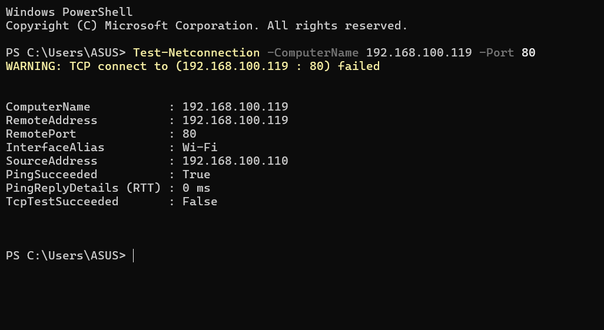

Ubuntu မှာ Windows client `192.168.100.110` ကိုသာ TCP port `80` ဝင်ခွင့်ပေးခဲ့ပါတယ်။ ကိုယ့် lab မှာ ပြန်လုပ်မယ်ဆို client IP ကို အစားထိုးပါ။

```bash
sudo ufw allow from 192.168.100.110 to any port 80 proto tcp
```

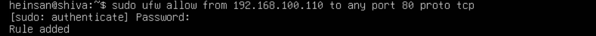

Windows test ထပ်လုပ်တော့ `TcpTestSucceeded: True` ဖြစ်သွားပြီး browser မှ Nginx welcome page ကို ဖွင့်နိုင်ခဲ့ပါတယ်။

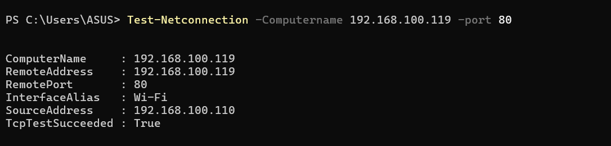

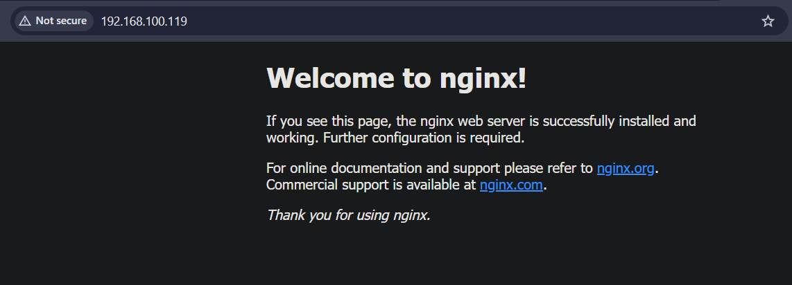

## 6. ကိုယ်ပိုင် page တင်ခြင်း

`sudo tee` နဲ့ root ပိုင် web directory `/var/www/html` ထဲ `lab.html` ကို ရေးခဲ့ပါတယ်။ Windows browser မှ `http://192.168.100.119/lab.html` ဖွင့်ရာ ကိုယ်ပိုင် heading ပေါ်လာပါတယ်။ Repo ထဲက [`lab.html`](lab.html) က deploy လုပ်ခဲ့တဲ့ file ရဲ့ copy ပါ။

```bash
echo '<h1>Hein San - Linux Sysadmin Lab</h1>' | sudo tee /var/www/html/lab.html
ls -l /var/www/html/lab.html
```

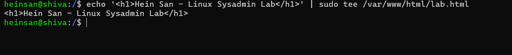

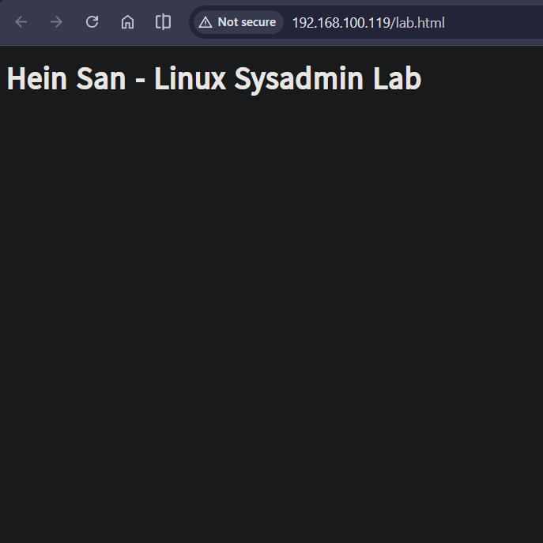

File က `root:root`, mode `644` ဖြစ်တာကြောင့် owner ကရေးနိုင်ပြီး Nginx က ဖတ်နိုင်ပါတယ်။

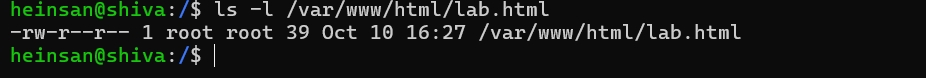

## 7. Logs နှင့် Git

Nginx `access.log` မှာ Windows client `192.168.100.110` ရဲ့ `GET /` ကို `200` အဖြစ် မှတ်ထားပါတယ်။ `127.0.0.1` ရဲ့ `HEAD /` `200` က local `curl -I` နဲ့ ကိုက်ညီပါတယ်။ `/favicon.ico` `404` က browser က icon ကိုတောင်းပေမယ့် file မရှိလို့ပါ။ **ဒီ log ပုံက default page ကို စမ်းခဲ့သည့်အချိန်က evidence ဖြစ်ပြီး `/lab.html` ရဲ့ log entry မဟုတ်ပါ။**

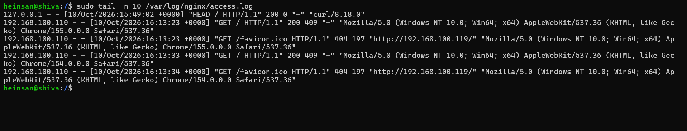

Git status မှာ README နဲ့ `lab.html` ကို stage လုပ်ထားတာ တွေ့ရပါတယ်။ **ပုံက commit သို့မဟုတ် GitHub push လုပ်ပြီးကြောင်း မပြပါ။**

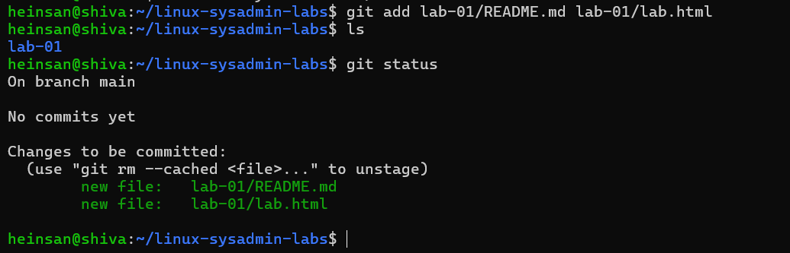

## သင်ယူခဲ့တာ

- Owner, group, mode, setgid နဲ့ shared directory access ထိန်းခြင်း
- SSH key နဲ့ Windows မှ Ubuntu VM ကို ဝင်ခြင်း
- `dpkg --audit` နဲ့ package state စစ်ပြီး pending configuration ပြုပြင်ခြင်း
- Nginx service, localhost HTTP, remote TCP ကို အဆင့်လိုက် ခွဲစစ်ခြင်း
- UFW မှာ client IP တစ်ခုကိုသာ HTTP access ပေးပြီး result ပြန်တိုင်းခြင်း
- Static page တင်ပြီး browser, permissions, logs ဖြင့် evidence စုခြင်း

## Repository files

```text
README.md          ဒီပုံပါ walkthrough
lab.html           deploy လုပ်ခဲ့သော page ၏ copy
screenshots/       lab ၏ actual evidence screenshots
```

README ကိုသာ copy/paste လုပ်ရင် ပုံတွေ မပေါ်ပါ။ GitHub repo ရဲ့ `screenshots/` folder ထဲကို image files တွေကိုလည်း တူညီတဲ့ filename နဲ့ upload လုပ်ပါ။ Public repo တင်မီ ပုံထဲက username နဲ့ private LAN IP တွေကို ကိုယ်တိုင်စစ်ပါ။ Password နှင့် SSH private key ပုံတွေကို ဒီ project ထဲ မထည့်ထားပါ။
